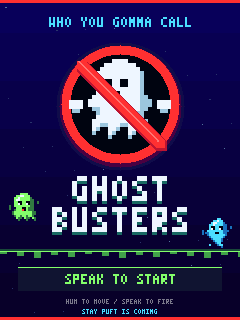
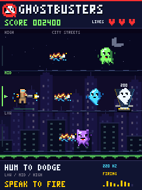
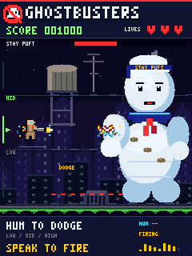
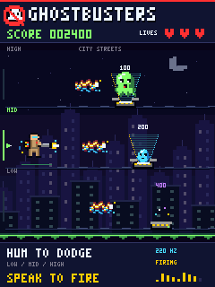
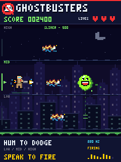
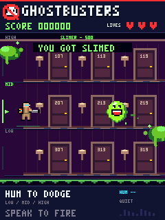
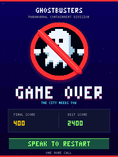

XU316 Ghostbusters hum game
==========================

Voice-controlled Ghostbusters-themed game on a 240×320 ST7789V portrait LCD,
using a 16 kHz PDM microphone, FFT and neural voice detector. Hum to change
lanes and speak to fire the proton pack.

Application source and tests are in this repository; upstream dependency
repositories live alongside it. The executable is
``app_xghostbusters/bin/xghostbusters.xe``.

Screenshots
-----------

Native-resolution previews generated by the same drawing code used on the LCD.

   Title screen: speak to answer the call.

   Gameplay: hum between three lanes and speak to fire.

   Stay Puft: dodge the warned lane and speak to wear down his health.

   Captures: ghosts shrink into a light cone before the trap snaps shut.

   Slimer: two hits, 500 points, and a habit of changing lanes.

.. list-table:: Haunted locations
   :header-rows: 1

   * - Sedgewick Hotel
     - Subway tunnels
     - Rooftops
   * - .. image:: docs/images/hotel.png
          :alt: Burgundy hotel corridor with numbered doors, brass lights and carpet.
          :width: 160 px
     - .. image:: docs/images/subway.png
          :alt: Tiled subway with steel pillars, track beds and a Downtown sign.
          :width: 160 px
     - .. image:: docs/images/rooftops.png
          :alt: Night rooftop with a water tower, antenna and vents.
          :width: 160 px

   Hit feedback: slime drips away while the centre and score remain readable.

   Game over: final score, session best and speech-driven restart.

Regenerate the PNGs from the repository root with Python 3 and clang::

   python3 tests/render_screenshots.py

Repository layout
-----------------

.. code-block:: text

   workspace/
   ├── ghostbusters/
   │   ├── app_xghostbusters/
   │   │   ├── CMakeLists.txt
   │   │   └── src/
   │   ├── tests/          # Host checks, renderer preview and acoustic tests
   │   ├── docs/images/    # README screenshots
   │   ├── README.rst
   │   └── requirements.txt
   ├── ai_tools/
   ├── lib_mic_array/
   ├── lib_spi/
   ├── lib_sw_pll/
   ├── lib_voice/
   ├── lib_xcore_math/
   └── xcommon_cmake/

All tests and screenshot-generation tools live in ``tests/``. Run the commands
below from ``ghostbusters/``. Build outputs, Python environments and generated
PPM previews are ignored by Git; the README PNGs are kept in ``docs/images/``.

Playing
-------

* **Speak to start** from the illustrated title screen. The first second after
  boot is reserved for microphone settling; humming does not start the game.
* Hum **low** (80–170 Hz) to move to the bottom lane, **mid** (170–260 Hz)
  for the middle, or **high** (260–500 Hz) for the top. Try 120, 220 and 330 Hz.
* Hold a pitch briefly to change lanes. Boundary hysteresis prevents jitter;
  silence or an unreliable pitch holds the last lane. Live pitch appears below.
* **Hum to move, speak to shoot**: the existing VAD enables firing only when an
  audio control filter also sees audible, non-hum input and a current VNR score
  of at least 0.45. Steady pitches and gentle pitch slides suppress shots even
  if raw VAD activates. A roughly 128 ms onset delay and short hum-dropout hold
  reduce accidental shots; silence suppresses VAD hangover shots. Speech can
  pause firing during sustained vowels. Short consonant-rich phrases such as
  "catch the ghosts" work better than sustained vowel sounds.
* Accepted speech repeatedly fires down the current lane, with a ten-frame
  cooldown. The footer shows **HUM**, **FIRING**, or **QUIET**.
* Ghost colours have different speeds, rewards and spawn probabilities:

  .. list-table:: Ghost types
     :header-rows: 1
     :widths: 20 30 20 30

     * - Colour
       - Relative speed
       - Points
       - Spawn chance
     * - Green
       - 1×
       - 100
       - 65%
     * - Cyan
       - 1.5×
       - 200
       - 25%
     * - Purple
       - 2×
       - 400
       - 10%

  All take one shot to destroy. Ghosts that pass in another lane do not cost a
  life. Difficulty increases every 500 points, preserving these speed ratios.

* **Stay Puft arrives at 1,000 points.** Normal ghosts pause while he rises behind
  the skyline. His health bar takes 18 shots to empty after his entrance. All
  three lanes can hit him. A red lane marker and **DODGE** warning give one second
  of notice before he throws a marshmallow down that lane. Hum into another lane,
  then speak to return fire. His face gets angrier and his suit scorches as his
  health falls. Defeating him awards **1,500 points** and triggers a marshmallow
  burst. Another encounter follows 2,500 points after the victory score.
* You have **three lives**. A collision costs one and gives two seconds of
  invulnerability. The HUD shows score, remaining lives and firing state.
* **Slimer appears from 300 points**, between boss encounters. He takes two
  shots to capture for **500 points**. Dotted slime trails signal a lane hop for
  ten frames; he never changes lanes when close to the player. His big grin,
  red tongue, drool and hit flash distinguish him from ordinary green ghosts.
  After capture or escape, his next visit unlocks 750 points beyond the current
  score. Stay Puft clears him from the screen while the boss encounter is active.
* **Locations change every 750 points:** city streets, Sedgewick Hotel, subway
  tunnels, then rooftops, repeating as your score grows. The location name glows
  briefly in the header on arrival; Slimer's name takes priority during his visit.
  Stay Puft always fights against the rooftop skyline.
* Taking damage splashes **YOU GOT SLIMED** across the top of the playfield.
  Corner splats drip and recede over 45 frames, keeping the centre, score and
  remaining lives clear. Invulnerability prevents repeated hits and splashes.
* At game over, stay quiet for one second, then speak to restart. The session
  best score survives restarts; power/reset clears it.

After starting, the opening message gives three seconds before the first ghost spawns.
Audio settles for one second after boot. All graphics are drawn on the LCD;
there are no host-side controls or external runtime image assets.

Build and run
-------------

With XMOS XTC 15.3.1 activated, CMake and Ninja installed:

.. code-block:: sh

   python3 -m venv .venv
   .venv/bin/python -m pip install -r requirements.txt
   export PATH="$PWD/.venv/bin:$PATH"
   cmake -G Ninja -S app_xghostbusters -B app_xghostbusters/build
   cmake --build app_xghostbusters/build
   xrun --adapter-id 94R8235L --noreset app_xghostbusters/bin/xghostbusters.xe

An existing Python environment with that AI tools version can be reused instead
of creating ``.venv``. The default dependency root is the repository's parent
directory; append ``-DXMOS_SANDBOX_DIR=/path/to/workspace`` to the CMake configure
command to override it. Use the pinned dependency versions listed under
`Upstream references`_ below.

``xrun`` loads RAM and returns with the application running. Reload after reset
or power cycling. This project has no flash configuration because the
custom-board flash model and wiring were not supplied.

Connections
-----------

.. list-table:: Board connections
   :header-rows: 1

   * - Function
     - Tile
     - Pin
     - XMOS port
   * - LCD SCLK
     - 0
     - X0D35
     - 1L
   * - LCD MOSI
     - 0
     - X0D36
     - 1M
   * - LCD CS
     - 0
     - X0D37
     - 1N
   * - LCD DC
     - 0
     - X0D38
     - 1O
   * - LCD reset
     - 0
     - X0D39
     - 1P
   * - Microphone data
     - 1
     - X1D25
     - 1J
   * - Microphone clock
     - 1
     - X1D35
     - 1L
   * - Application PLL output/feedback
     - 1
     - X1D11
     - 1D

X1D11 is driven at 24.576 MHz by the application PLL and read through port 1D
for clock division. No external loopback is needed. The PLL uses the board's
24 MHz oscillator. Microphone clock is 3.072 MHz, decimation is 192:1, and PCM
rate is 16 kHz. Both PDM edges are captured; one microphone channel is selected
after startup. The backlight is assumed powered externally.

LCD uses mode-0 write-only SPI at 600 MHz / (4×5) = 30 MHz. No MISO resource is
allocated. ``app_xghostbusters/src/custom_xu316.xn`` uses the XU316-1024-QF60A
target at 600 MHz; the precise custom-board package/speed grade was not supplied.
Verify this target against the board BOM before adopting it for production.

Processing and display
----------------------

* Tile 1: independent PDM receiver and decimator threads from ``lib_mic_array``.
* Tile 0: continuous PCM receiver, FFT/pitch/VAD processor, latest-value mailbox,
  and game/LCD thread.
* A 64-frame (128 ms) single-producer/single-consumer queue separates audio
  reception from FFT calculation; no audio samples depend on LCD timing.
* 1,024-point real block-floating-point FFT, Hann window, 512-sample hop.
* 32 logarithmic bands from approximately 62.5 Hz to just below 8 kHz.
* Peak-bin level per band, FFT-exponent and window-gain compensation.
* The FFT and spectrum band data remain available internally; the LCD now shows
  the game instead of FFT bars.
* Humming uses a DC-removed, 4 kHz decimated YIN-style periodicity detector over
  the same 1,024-sample history, with a −78 dBFS RMS gate and periodicity gate.
  It prefers the fundamental over stronger harmonics. Lane changes require three
  stable display frames with 15 Hz hysteresis around the boundaries.
* Layered night skyline with lit windows, stars, crescent moon and slime edging.
  Shaded, bobbing ghosts have three distinct silhouettes; the suited Ghostbuster
  has goggles, a proton pack and a flashing wand. Twisting orange/blue energy
  bolts, electrical sparks and rising point labels provide firing and hit feedback.
* Captured ghosts flash, squash and spiral into a striped trap's light cone.
  The split lid snaps shut and its containment indicator turns green. Captures
  last 32 frames; points are awarded immediately on impact.
* Large shaded Stay Puft with a sailor hat, blue collar, red neckerchief, moving
  arm, changing expression, accumulating scorch marks and a marshmallow-burst
  defeat. His two-second entrance is invulnerable; his three-second defeat
  sequence clears attacks and gives the player a breather.
* Framed HUD, full-screen game-over poster with a large shaded no-ghost emblem,
  final/best scores and quiet-to-restart progress, highlighted pitch lane,
  and a hum/fire activity indicator. The activity bars show control state,
  rather than measured microphone amplitude.
* Fixed pools: eight ordinary ghosts, one Slimer, six shots, six capture effects
  and three boss attacks.
* Target 30 fps. Each eight-row strip is drawn once and compared exactly against
  a 153,600-byte cache of the previous LCD image. Only changed columns within
  changed strips are transmitted. No tearing-effect input is connected.
* Tile 0 uses approximately 371 KB of its 512 KB memory, including code, stack,
  model data and the LCD cache. Full-screen scene transitions may take longer
  than one 33 ms frame; sustained animation is checked separately below.

Voice detection
---------------

The footer displays **FIRING** for accepted speech, **HUM** for tonal movement
input, and **QUIET** otherwise. Raw voice detection is filtered for game controls.
XMOS ``lib_voice`` v1.1.0 provides the neural-network voice-to-noise estimator
(VNR). It processes 240 new Q1.31 PCM samples every 15 ms at 16 kHz, using its own
512-point transform, MEL features and pretrained model. Its 0–1 output estimates
speech strength relative to noise, not a probability.

``app_xghostbusters/src/voice.c`` uses an onset threshold of 0.60, continuation
threshold of 0.45, a two-frame attack, a 300 ms hold, and a −80 dBFS energy gate.
Detection starts after one second of microphone settling. These are practical
starting settings, not an accuracy guarantee for all music and environmental
sounds.

Detection runs in the existing spectrum-processing thread, keeping the total at
**six hardware threads**. On the board, estimation took approximately 0.93 ms
per 15 ms frame, with zero audio receive-queue overruns during acoustic tests.
The model is compiled for one core by ``xcore-opt`` from the pinned AI tools package.

.. code-block:: sh

   python3 tests/validate_voice.py

This plays synthetic speech through the Mac's current output and checks that
VOICE activates, then returns to QUIET, while capture timing and overruns remain
correct. Keep the speaker audible to the board and avoid talking during the
quiet-recovery measurement. ``voice_diag`` exposes the live score (0–1000), active
state, RMS, transition/frame counts, and processing timing in 100 MHz ticks.

Levels are relative to digital full scale, not calibrated sound-pressure levels.
Panel rotation, RGB order and inversion are in ``app_xghostbusters/src/display.c``.

Validation
----------

Host pitch and game regression checks (including strong harmonics, noise/DC
rejection, lane hysteresis, scoring, invulnerability, three lives, restart and a
30,000-frame simulation):

.. code-block:: sh

   clang -std=c99 -Wall -Wextra -Werror -fsanitize=address,undefined \
     -Iapp_xghostbusters/src tests/validate_game.c \
     app_xghostbusters/src/{game,pitch,controls}.c -lm -o /tmp/validate_game
   /tmp/validate_game

Host renderer checks and optional native-resolution preview (title, gameplay,
game over, Stay Puft, traps, Slimer, haunted locations and slime-hit feedback):

.. code-block:: sh

   clang -std=c99 -Wall -Wextra -Werror -fsanitize=address,undefined \
     -Iapp_xghostbusters/src tests/validate_display.c \
     app_xghostbusters/src/game.c -o /tmp/validate_display
   /tmp/validate_display /tmp/ghostbusters-preview.ppm

These check deterministic, fully painted strips, exact changed-column bounds,
actors and effects clipped at screen edges, every capture phase, boss entrance
and defeat, title animation, and capture-effect creation and expiry. Game tests
also cover speech-to-start, boss attack warnings, invulnerability, hits, rewards,
repeat encounters, Slimer's two-hit capture and lane-hop rules, location cycling,
slime expiry and restart cleanup. Renderer checks exercise all locations, slime
phases and Slimer captures, including sprites partly outside the screen.

On-board visual timing smoke test (XTAG only, no acoustic input needed):

.. code-block:: sh

   python3 tests/validate_visuals.py

This injects representative scenes through a breakpoint at ``game_step``,
discards full-screen transition frames, measures peak frame work and audio queue
overruns over running intervals, and reloads the title screen afterwards.
Measured peaks on the connected board were 20.38 ms for the title, 30.68 ms for
Stay Puft's entrance, 22.23 ms for attacks, 22.66 ms for three simultaneous traps,
and 24.14 ms for the marshmallow burst. Slimer with slime splats peaked at
23.10 ms in the city, 23.67 ms in the hotel, 22.20 ms in the subway and 22.77 ms
on the rooftops; a Slimer trap capture peaked at 20.22 ms. There were no missed
33 ms animation budgets or audio queue overruns in those intervals. Full-screen
scene changes are tracked separately and may take longer than one frame.

On-board game controls test (plays tones and speech on the host's current audio
output; the speaker must be audible to the board):

.. code-block:: sh

   python3 tests/validate_controls.py

This reloads the board for each trial, speaks to start, and verifies 120/220/330 Hz select the bottom,
middle and top lanes without firing, and checks a harmonic pitch slide/vibrato
also moves without firing. It checks quiet release and confirms speech produces
actual proton shots. Host tests additionally inject full-strength VAD during
humming, check speech transitions and hangover rejection, and verify all ghost
speeds/rewards and weighted spawning over 20,000 spawns. Acoustic tests passed on
the connected board with zero audio overruns and render work within the 33 ms
frame budget (approximately 20–30 ms in these trials).
Physical panel appearance still requires visual confirmation.

Startup performs on-device assertions for a 1 kHz, −6.02 dBFS synthetic sine and
silence. Real microphone capture was checked using host-speaker acoustic tones
at 500, 1000 and 2000 Hz; detected dominant bins matched all three exactly.

.. code-block:: sh

   python3 tests/validate_audio.py

The script plays four-second tones on the Mac's current output and briefly
attaches the debugger for each measurement; the target resumes on detach.
The speaker must be audible to the board microphones.

Useful debugger variables on tile 0:

* ``audio_diag``: FFT test result, live frequency, per-channel RMS, FFT timing.
* ``capture_second_ticks``: elapsed 100 MHz timer ticks for 16,000 samples;
  measured **100,000,000**, corresponding to 16,000 samples/second.
* ``capture_overruns``: receive-queue overruns; measured **0**.
* ``display_frames``, ``display_last_spectrum``, ``display_frame_ticks``.
* ``display_peak_ticks``, ``display_budget_misses``: peak frame work and missed
  33 ms animation budgets since startup or the last diagnostic reset, excluding
  full-screen scene changes. ``display_transition_ticks`` records the latest
  full-screen transition separately. Set
  ``display_reset_stats`` to 1 to reset these at the next frame boundary.
* ``audio_diag.hum_hz``: confident fundamental or zero.
* ``game_diag``: score, best, lives, lane (0=top, 1=middle, 2=bottom), VAD state,
  ghosts, shots, invulnerability and restart state.
* ``game_diag.title``, ``game_diag.boss_active``, ``game_diag.boss_hp``,
  ``game_diag.boss_defeat``, ``game_diag.bosses_defeated``: title and boss state.
* ``game_diag.slimer``, ``game_diag.slimer_next``, ``game_diag.slime_ticks``:
  Slimer's state, next score threshold and remaining slime-overlay frames.
* ``game_diag.location``, ``game_diag.location_flash``: haunted location (0–3)
  and remaining header-highlight frames.
* ``game_diag.voice`` is the filtered firing state; ``game_diag.hum`` is hum status;
  ``game_diag.shots_fired`` counts shots since the current game started.
* ``controls_diag``: tonal hold, speech evidence, onset delay and filtered fire.

Debugger pauses disturb a live stream; use subsequent full running intervals
for timing measurements. Physical panel appearance requires visual confirmation
because no display readback or camera is available.

Upstream references
-------------------

Pinned official XMOS releases (their licences remain in each library folder):

* `lib_mic_array v7.1.0 <https://github.com/xmos/lib_mic_array/tree/v7.1.0>`_
* `lib_xcore_math v3.0.0 <https://github.com/xmos/lib_xcore_math/tree/v3.0.0>`_
* `lib_spi v4.0.0 <https://github.com/xmos/lib_spi/tree/v4.0.0>`_
* `lib_sw_pll v2.5.0 <https://github.com/xmos/lib_sw_pll/tree/v2.5.0>`_
* `xcommon_cmake v1.3.0 <https://github.com/xmos/xcommon_cmake/tree/v1.3.0>`_
* `lib_voice v1.1.0 <https://github.com/xmos/lib_voice/tree/v1.1.0>`_
* `ai_tools v1.4.3.dev40 <https://github.com/xmos/ai_tools/tree/v1.4.3.dev40>`_

The library's C SPI implementation exposes its API through ``src/spi_fwk.h``;
the ``api/spi.h`` wrapper is for XC interfaces. The application uses the existing
C implementation directly. ST7789 reset/pixel-format/sleep/inversion commands
were cross-checked against the public Adafruit ST7789 driver.
